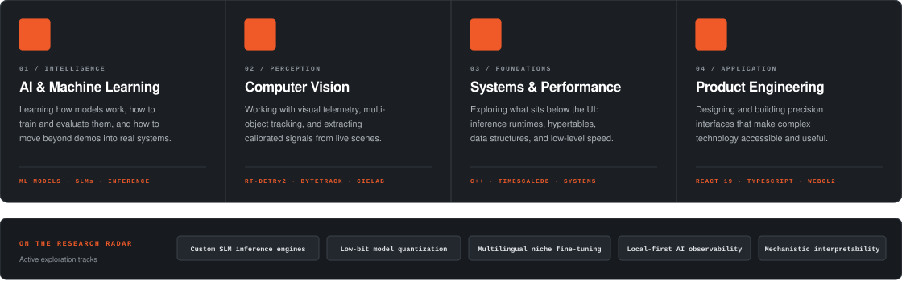
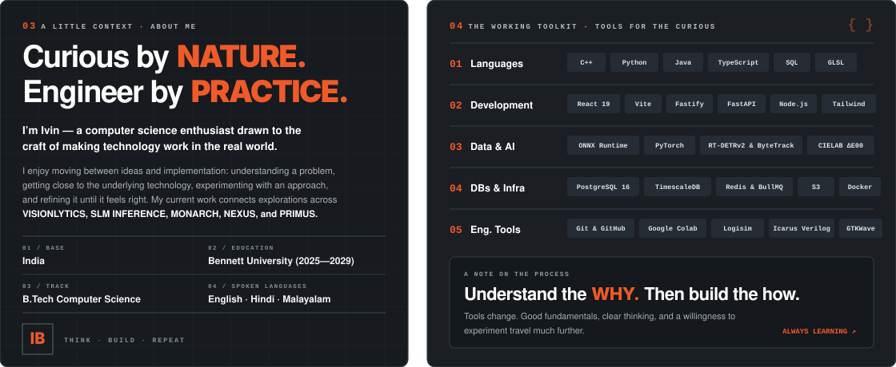
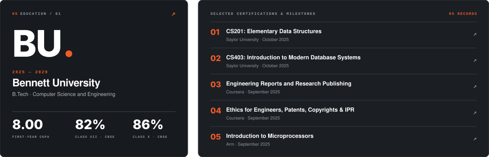
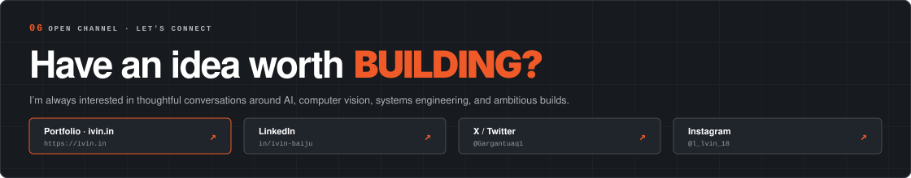

<!-- ==================== 00. ANIMATED IVIN.IN HERO BANNER ==================== -->

 

<!-- ==================== ANIMATED SIGNAL STRIP ==================== -->

  

---

## `01` · SELECTED WORK & EXPERIMENTS — *Things I’m bringing to life.*

> A mix of production systems, custom inference engines, and spatial intelligence consoles. I care about the problem, the mathematical architecture behind the solution, and the engineering details that make it genuinely useful.

  

 

<table>
  <tr>
    <td width="50%" valign="top">
      <h3><code>V / 001</code> · <a href="https://github.com/ivin-baiju/Visionlytics">Visionlytics v1.0</a></h3>
      
<b>COMPUTER VISION SAAS · MULTI-OBJECT TRACKING · APACHE-2.0 ONNX</b>

      
Full-stack, multi-tenant computer vision SaaS platform analysing images, videos, live webcams, and RTSP streams per frame — rebuilt from scratch as a Turborepo monorepo.

      <ul>
        <li><b>Detection &amp; Tracking:</b> Calibrated Apache-2.0 <b>RT-DETRv2-R18vd</b> &amp; <b>YOLOS-Tiny ONNX</b> (+ SAHI 2×2 tiled pass) paired with <b>ByteTrack</b> (Alpha-Beta Kalman filter + 26-d HSV/Lab appearance Re-ID).</li>
        <li><b>Perceptual Garment Colour Pipeline:</b> Elliptical foreground mask + 15% border-ring subtraction, k-means (<code>k = 3</code>) in <b>CIELAB</b> space, and <b>CIEDE2000 (ΔE00)</b> matching across a 28-colour palette with upper-torso / lower-leg split.</li>
        <li><b>Measured Golden Telemetry:</b> <code>mAP@50: 91.43%</code> · <code>mAP@50:95: 85.14%</code> · <code>CIEDE2000 Acc: 85.71%</code> · <code>Person Count MAE: 0.00</code> · <code>60 FPS</code> WebGL2 + Canvas HUD.</li>
      </ul>
      

        <a href="https://ivin-baiju.github.io/Visionlytics/"><b>Open Live App ↗</b></a> ·
        <a href="https://github.com/ivin-baiju/Visionlytics"><b>Source Code &amp; Architecture ↗</b></a>
      

    </td>
    <td width="50%" valign="top">
      <h3><code>L / 004</code> · <a href="https://github.com/ivin-baiju/Custom_SLM_Inference">Custom SLM Inference Engine</a></h3>
      
<b>FROM-SCRATCH TRANSFORMER RUNTIME · APPLE SILICON M4 MPS</b>

      
Bespoke small-language-model inference engine hand-forged in PyTorch for Apple Silicon — zero <code>transformers.generate()</code> wrappers, streaming safetensor weights layer-by-layer.

      <ul>
        <li><b>Hand-Written Architecture:</b> Explicit <b>RoPE</b> rotary embeddings, <b>Grouped-Query Attention (GQA)</b>, <b>SwiGLU</b> MLP projections, RMSNorm, and pre-allocated static KV-cache.</li>
        <li><b>Low-Bit Quantization:</b> Layer-streamed INT8 &amp; INT4 weight quantization fitting <b>Qwen2.5-3B</b> into just <b>4.13 GB VRAM</b> on a 16 GB Unified Memory Mac.</li>
        <li><b>Measured Benchmarks:</b> <code>1.00000179</code> cosine logits parity vs HuggingFace · <code>48.3 tps</code> FP16 on Qwen2.5-0.5B (<code>36.8 ms</code> TTFT) · <code>19/19</code> pytest suite passing.</li>
      </ul>
      

        <a href="https://github.com/ivin-baiju/Custom_SLM_Inference"><b>Explore Repository &amp; Benchmarks ↗</b></a>
      

    </td>
  </tr>
  <tr>
    <td width="50%" valign="top">
      <h3><code>M / 002</code> · <a href="https://ivin.in/#work">MONARCH</a></h3>
      
<b>GEOSPATIAL INTELLIGENCE CONSOLE · PRODUCT ENGINEERING</b>

      
A dark-first spatial intelligence console built around georeferenced imagery, mapped coordinate bounds (<code>28° 27′ 18″ N, 77° 30′ 09″ E</code>), 8 active spatial layers, and 12 live telemetry sources.

      <ul>
        <li><b>Stack:</b> React, TypeScript, Framer Motion, geospatial layer orchestration, and high-contrast tactical UI ergonomics.</li>
      </ul>
      
<a href="https://ivin.in/#work"><b>View on ivin.in ↗</b></a>

    </td>
    <td width="50%" valign="top">
      <h3><code>S / 003</code> · <a href="https://ivin.in/#work">ATC Simulation</a></h3>
      
<b>AI · REAL-TIME AIRSPACE &amp; CONFLICT SIMULATION</b>

      
An AI air-traffic-control simulation concept: replay multi-aircraft flight corridors, inject close-call separation scenarios, detect trajectory conflicts, and evaluate autonomous controller instructions.

      <ul>
        <li><b>Focus:</b> Multi-agent simulation, trajectory conflict detection, decision-support telemetry, and radar HUD visualization.</li>
      </ul>
      
<a href="https://ivin.in/#work"><b>View on ivin.in ↗</b></a>

    </td>
  </tr>
</table>

---

## `02` · BEYOND THE SURFACE LAYER — *The interests that drive the build.*

> I’m drawn to the layers underneath a product: the models, data, mathematical guarantees, and systems decisions that make the experience possible.

  

---

## `03 & 04` · ABOUT ME & THE WORKING TOOLKIT — *Curious by nature. Engineer by practice.*

  

---

## `05` · THE FOUNDATIONS — *Learning is part of the build.*

> Formal foundations matter. So does staying curious outside the syllabus. Here is a snapshot of my academic path at **Bennett University** and selected engineering certifications.

  

---

## `06` · OPEN CHANNEL — *Have an idea worth building?*

  

   

  <b>&lt;/&gt; ivin.</b> · Designed around curiosity. Built with intent. · <b>INDIA · UTC +05:30</b> · <a href="mailto:lightningspeed.flh@gmail.com">lightningspeed.flh@gmail.com</a>

